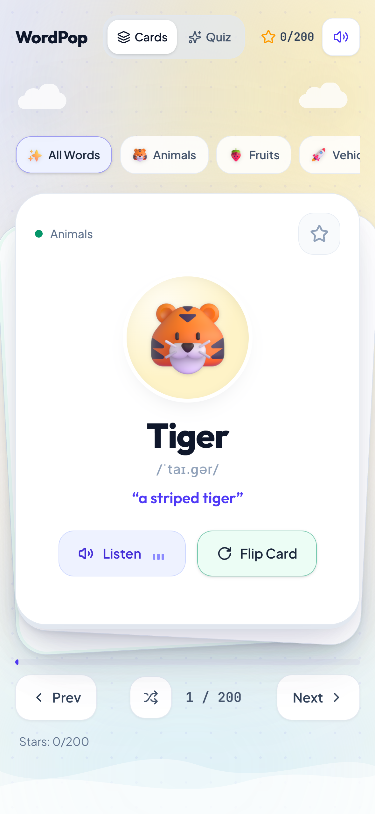

# word-cards

Warm, minimalist English flashcards for kids (3–6) designed for quick daily practice.
Each card pairs a clear word with a short, kid-friendly example phrase.
Swipe through the deck like real cards—simple UI, big type, and low distraction.

[Try WordPop](https://wordpop.blazorserver.com/)



Swipe left/right to move through cards.

## Tech

- Vite + React + TypeScript
- Tailwind CSS v4
- Framer Motion (swipe interactions)
- Web Audio API sound effects

## Getting Started

### 1) Install

```bash
npm install
```

### 2) Run

```bash
npm run dev
```

Open http://localhost:3000

### Local pronunciation service

Copy `.env.example` to `.env.local` and set `TTS_API_URL` to the speech
service's base URL and `TTS_API_KEY` to its API key. The default URL is
`http://127.0.0.1:48731`; requests use model `tts-1` and voice `alloy`. Restart
`npm run dev` after changing either environment variable. The Vite development
server proxies speech requests so the key stays on the server.

The Docker image also proxies speech requests using `TTS_API_URL` and
`TTS_API_KEY` supplied to the container. GitHub Pages needs a separate
server-side proxy for pronunciation.

### Speak pronunciation practice

The card front scores the word with Alibaba Cloud's child word model. The back
scores the story sentence with its child sentence model. Scores below 65 prompt
another try, 65–84 are good, and 85–100 are great. Recordings play locally.
Flipping or changing cards clears the current practice session. If recording
or cloud scoring is unavailable, the result is marked Demo.

For local development, download the [Alibaba Cloud JavaScript SDK](https://help.aliyun.com/zh/document_detail/2873513.html)
from the speech assessment project in the console and place `engine.js` and any
accompanying runtime files in `public/sdk/`. Add `SPEAK_APP_ID` and
`SPEAK_APP_SECRET` to `.env.local`, plus `SPEAK_LOCAL_CLIENT_IP` with your public
client IP when testing through localhost. Restart Vite. The browser needs
HTTPS or localhost to use the microphone.

For deployment, include the downloaded SDK when building the app. Run
`node server/speak-auth.mjs` with Node.js 24 and the same server-side credential
variables. In your HTTPS reverse proxy, route `POST /api/speak/authorize` to
`http://127.0.0.1:4318` and overwrite `X-Real-IP` with the actual client IP.
Apply your deployment's access controls and rate limits to this route. The
SDK uses the short-lived authorization returned by this endpoint.

## Content

Flashcard content lives in `src/data/vocabData.ts`.

## Deployment

### GitHub Pages

In the repository settings, under **Pages**, set the source to **GitHub Actions**.
Push to `main` or run the **Deploy GitHub Pages** workflow manually. The workflow
uses the Pages base path so that scripts and card images also work under a
repository subpath.

### Docker and Portainer

Pushes to `main` build and publish `ghcr.io/neozhu/word-cards:latest`. After the
first publish, make the GHCR package public, or configure a GHCR registry in
Portainer with credentials that can read the package.

In Portainer, create a stack from this Git repository, select the `main` branch
and `docker-compose.yml`, then enable **GitOps updates** with the **Webhook**
mechanism and **Re-pull image**. Add the generated webhook URL as the GitHub
Actions repository secret `PORTAINER_WEBHOOK_URL`. The image workflow calls it
after a successful push; the Portainer URL must be reachable from GitHub Actions.
Do not also enable a separate polling update: it can deploy a Git commit before
its image has finished building.

Portainer's GitOps webhook updates only when the Git commit changes. If you
manually rebuild the same commit, use **Pull and redeploy** in Portainer to pick
up the new image. The application is available on port `8080` by default; change
the host port in `docker-compose.yml` if needed.

Set `TTS_API_URL` and `TTS_API_KEY` in the deployment environment or a Compose
`.env` file. The URL must be reachable from the container; for a service on the
Docker host, the Compose default is `http://host.docker.internal:48731`. Recreate
the container after changing these values.

## AI Disclosure

Some of the flashcard content (especially example phrases) may be AI-generated. Please review and edit `src/data/vocabData.ts` as needed.
