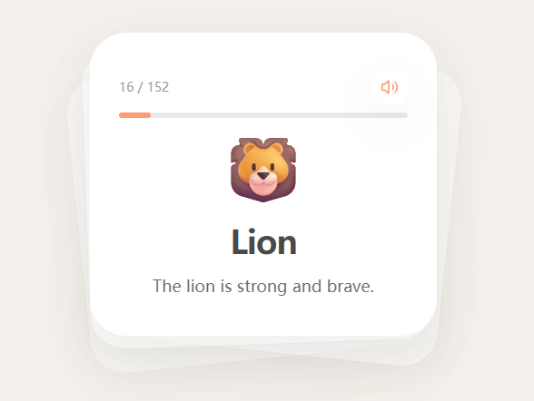

# word-cards

Warm, minimalist English flashcards for kids (3–6) designed for quick daily practice.
Each card pairs a clear word with a short, kid-friendly example phrase.
Swipe through the deck like real cards—simple UI, big type, and low distraction.



Swipe left/right to move through cards.

## Tech

- Vite + React + TypeScript
- Tailwind CSS v4
- Framer Motion (swipe interactions)
- Web Audio API sound effects

## Getting Started

### 1) Install

```bash
npm install
```

### 2) Run

```bash
npm run dev
```

Open http://localhost:3000

### Local pronunciation service

Copy `.env.example` to `.env.local` and set `TTS_API_URL` to the speech
service's base URL and `TTS_API_KEY` to its API key. The default URL is
`http://127.0.0.1:48731`; requests use model `tts-1` and voice `alloy`. Restart
`npm run dev` after changing either environment variable. The Vite development
server proxies speech requests so the key stays on the server.

This proxy is for local development; GitHub Pages and the Docker image need a
separate server-side proxy for pronunciation.

## Content

Flashcard content lives in `src/data/vocabData.ts`.

## Deployment

### GitHub Pages

In the repository settings, under **Pages**, set the source to **GitHub Actions**.
Push to `main` or run the **Deploy GitHub Pages** workflow manually. The workflow
uses the Pages base path so that scripts and card images also work under a
repository subpath.

### Docker and Portainer

Pushes to `main` build and publish `ghcr.io/neozhu/word-cards:latest`. After the
first publish, make the GHCR package public, or configure a GHCR registry in
Portainer with credentials that can read the package.

In Portainer, create a stack from this Git repository, select the `main` branch
and `docker-compose.yml`, then enable **GitOps updates** with the **Webhook**
mechanism and **Re-pull image**. Add the generated webhook URL as the GitHub
Actions repository secret `PORTAINER_WEBHOOK_URL`. The image workflow calls it
after a successful push; the Portainer URL must be reachable from GitHub Actions.
Do not also enable a separate polling update: it can deploy a Git commit before
its image has finished building.

Portainer's GitOps webhook updates only when the Git commit changes. If you
manually rebuild the same commit, use **Pull and redeploy** in Portainer to pick
up the new image. The application is available on port `8080` by default; change
the host port in `docker-compose.yml` if needed.

## AI Disclosure

Some of the flashcard content (especially example phrases) may be AI-generated. Please review and edit `src/data/vocabData.ts` as needed.
